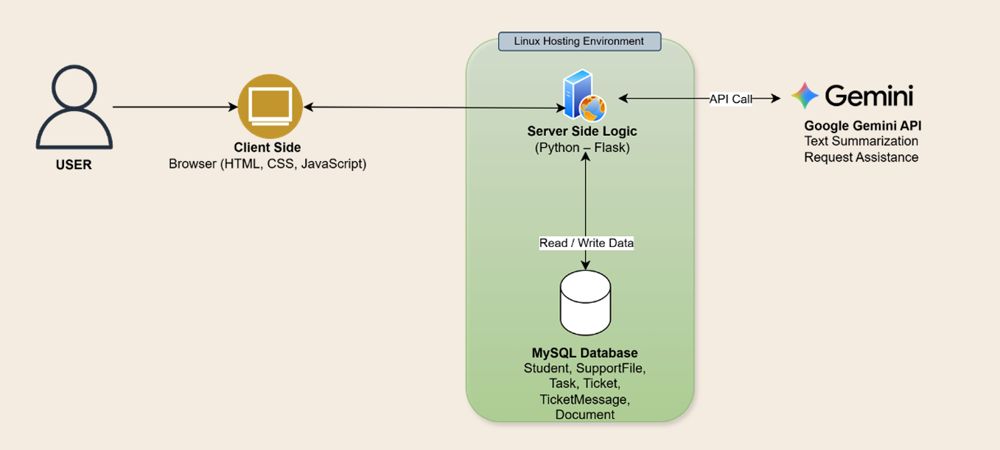

#  Academic Student Support System

**A web-based student support and case-management platform built as a B.Sc. Information Systems capstone project.**

LIVU helps academic support staff manage student cases, coordinate follow-up activities, document conversations, and track progress in one place. The project was developed by a **three-person team** for an academic support use case at **The Academic College of Tel Aviv–Yaffo** and was recognized among the **top five capstone projects** in its cohort.

> **Project status:** Academic prototype. The core case-management, ticketing, document, task, progress-tracking, and AI-assistance workflows are implemented. Some additional screens are visual demonstrations rather than fully functional modules.

## The problem

Academic support processes can involve multiple stakeholders, scattered communications, separate documents, and manual follow-ups. Without a centralized view, it is difficult to understand a student's case history, identify pending tasks, and keep track of progress.

**The system brings these activities into a single workflow**, giving support coordinators a clearer view of student needs, open requests, case documentation, and action items.

## Implemented features

### Student and case management
- Create, view, update, and remove student records.
- Track support cases and their statuses.
- Access student details, case plans, and conversation summaries.
- Attach, retrieve, and delete documents related to a student.

### Ticketing and communication
- Create and manage student-related inquiries (tickets).
- Maintain message histories within each ticket.
- Track ticket statuses and follow-up communication.

### Task and progress tracking
- Create tasks linked to individual students.
- Update task statuses: **Open**, **In Progress**, or **Completed**.
- Calculate progress percentages from completed tasks.
- Highlight overdue work and display a student leaderboard.

### AI-powered assistance
Using the **Google Gemini API**, the system supports:
- Drafting replies to student inquiries.
- Suggesting next steps and follow-up tasks.
- Summarizing ticket content and written conversations.
- Transcribing uploaded audio and generating structured summaries.

AI suggestions are intended to **assist staff**, not independently approve academic accommodations or replace human decisions.

## Prototype-only screens

The repository also includes interface mockups for a general dashboard, academic accommodations, and reporting. These pages demonstrate the proposed user experience but **are not fully implemented**. The login screen uses a **client-side demo mechanism**, and institutional SSO is not connected.

## My contribution

As part of a three-person development team, I contributed to the system's technical architecture, development, and deployment.
My key contributions included:

-System Architecture & Technology Selection: Planned the application's technical architecture and selected the technology stack, including Flask, Python, JavaScript, and  MySQL.
-AI Chatbot Development: Developed and integrated an AI-powered chatbot using the Google Gemini API.
-API Integration: Configured the Gemini API integration and managed the API key using environment variables (.env).
-Linux Server Deployment: Connected to a remote Linux server and uploaded the application files as part of the deployment process.
-Full-Stack Development: Contributed to frontend and backend implementation across the system's workflows, collaborating with other team members.

The project also involved end-to-end information-systems work, from understanding the support process and designing workflows to implementing and integrating system components.

## Technology stack

| Layer | Technologies |
| --- | --- |
| Frontend | HTML, CSS, JavaScript |
| Backend | Python, Flask, REST-style JSON APIs |
| Database | MySQL, SQLAlchemy, PyMySQL |
| AI integration | Google Gemini API |
| Integration | HTTP requests, JSON, Fetch API |
| Development & hosting | Git, GitHub, Linux/Ubuntu |

## Deployment

The application was previously hosted on a remote Linux server for academic demonstration purposes. The hosted version is no longer available, but the source code remains accessible in this repository.

## System Architecture

The system follows a client-server architecture and was deployed on a Linux-based hosting environment.



-Frontend: HTML, CSS, and JavaScript provide the user interface.
-Backend: Python and Flask handle application logic, API requests, and communication with the database.
-Database: MySQL stores student records, support cases, tasks, tickets, messages, and document-related data.
-AI Integration: Google Gemini API enables AI-powered chatbot assistance and text summarization.
-Hosting: The application was deployed on a Linux server during the academic project. The hosted version is no longer available.

The architecture separates the presentation layer, application logic, and data storage, while integrating external AI services through API calls.


### Main data entities

`students` · `support_files` · `tasks` · `tickets` · `ticket_messages` · `documents`

### Selected API endpoints

| Method | Endpoint | Purpose |
| --- | --- | --- |
| `GET` / `POST` | `/students` | List or create students |
| `PATCH` | `/students/<student_id>` | Update student details |
| `GET` / `POST` | `/students/<student_id>/tasks` | Retrieve or create student tasks |
| `PUT` | `/tasks/<task_id>` | Update task status |
| `GET` | `/api/progress` | Retrieve student progress metrics |
| `GET` / `POST` | `/api/tickets` | List or create tickets |
| `GET` / `POST` | `/api/tickets/<ticket_id>/messages` | Retrieve or add ticket messages |
| `GET` / `POST` | `/students/<student_id>/documents` | Retrieve or upload documents |
| `POST` | `/chatbot/message` | Request AI assistance |
| `POST` | `/summarize` | Generate a conversation summary |
| `POST` | `/transcribe-audio` | Transcribe an audio upload |

## Repository structure

```text
Academic-Support-System/
├── CSS/                 # Page and component styles
├── html/                # HTML views
├── js/                  # Client-side behavior and API integration
├── python/
│   └── app.py           # Flask server, models, and API routes
├── uploads/             # Runtime-upload directory (contents ignored)
└── .gitignore
```

**Academic capstone project · B.Sc. Information Systems · The Academic College of Tel Aviv–Yaffo**
